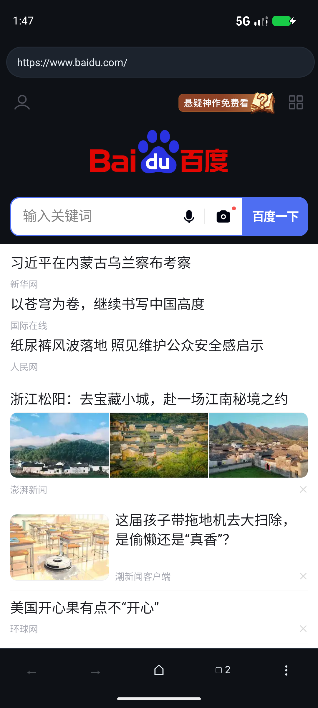
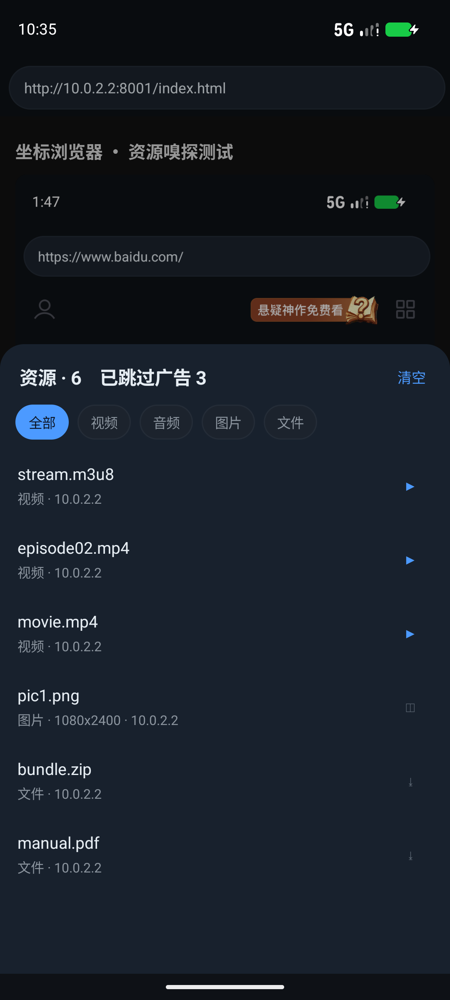
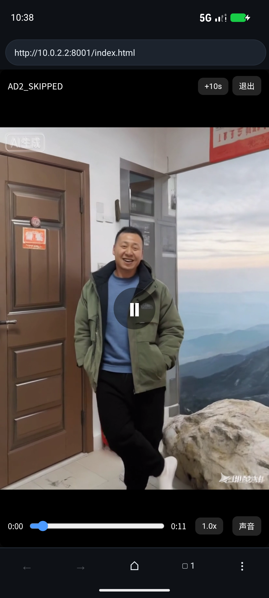
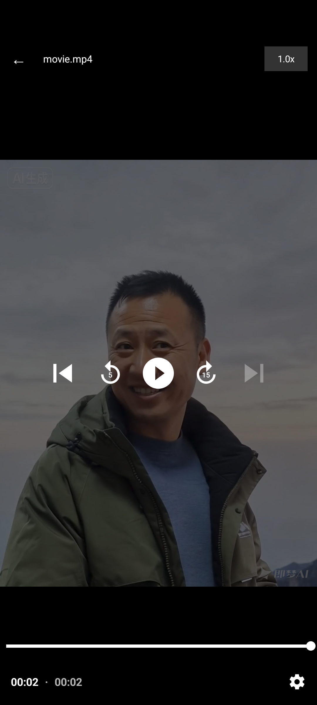
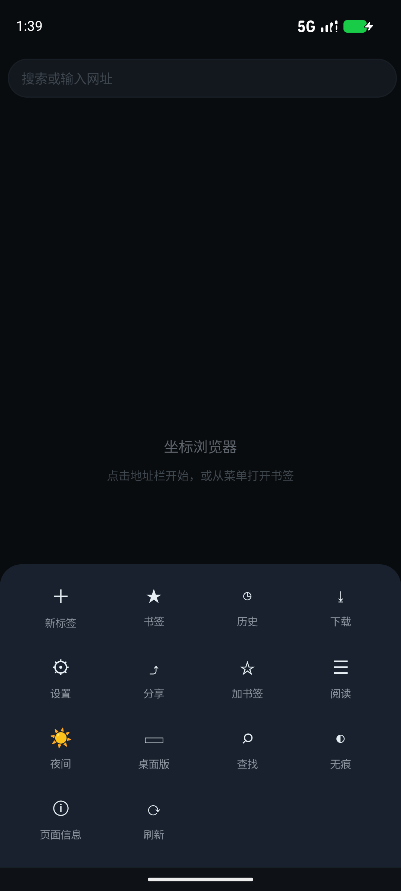
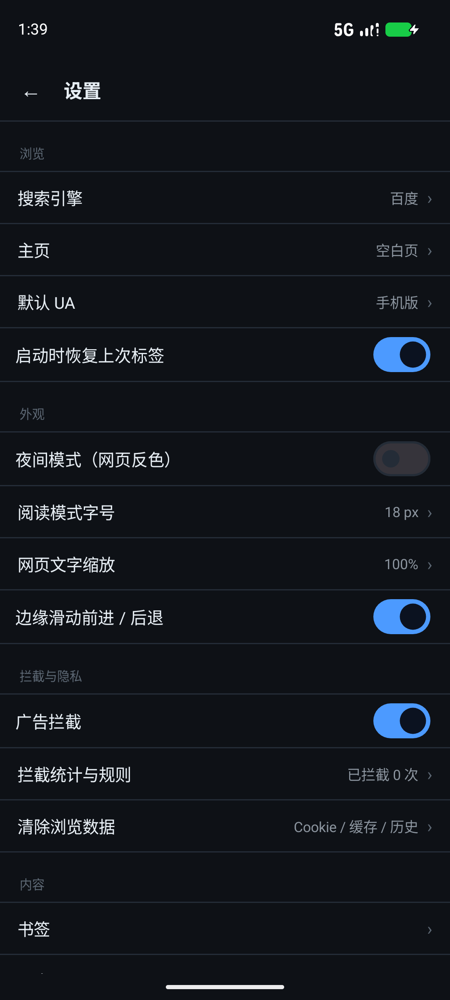

# 坐标浏览器 · Zuobiao Browser

[](https://github.com/123456789-Liu1/zuobiao-browser/releases)
[](LICENSE)

**下载 APK**：[Releases](https://github.com/123456789-Liu1/zuobiao-browser/releases) · **源码**：[GitHub](https://github.com/123456789-Liu1/zuobiao-browser)

把 8 款主流浏览器拆开分析之后，挑出「真正有用、且不靠内容生态」的那批能力，做成的一个轻量 Android 浏览器。

- 内核：系统 WebView（不自带 Chromium）
- 形态：纯工具型，无信息流、无账号、无广告、无后台上报
- 技术栈：Java 17 · minSdk 24 · targetSdk 34 · AndroidX + Material 3 · Media3(ExoPlayer)
- 版本：**1.3.0**（`ZuobiaoBrowser-1.3.0.apk`，release 已签名，2.6 MB）

| 浏览 | 资源嗅探 | 影院模式 |
|---|---|---|
|  |  |  |

| 原生播放器 | 底部抽屉 | 设置 |
|---|---|---|
|  |  |  |

---

## 一、功能清单

### 浏览
| 功能 | 说明 |
|---|---|
| 多标签 | 最多 20 个；标签总览（2 列卡片）、长按关闭、关闭后自动切换；重启/被杀后恢复上次会话 |
| 地址栏 | **常态是只读域名条**（`baidu.com/s ▾`），点击才展开成输入框；自动识别网址与搜索词；6 个搜索引擎 |
| 滚动收起 | 页面向下滚动时地址条自动收起，上滑或换页恢复；百度/搜狗等结果页的页面搜索框成为唯一主入口 |
| 导航 | 前进 / 后退 / 刷新 / 停止 / 主页；**边缘滑动**前进后退 |
| 下拉刷新 | 顶部下拉重新加载 |
| 页内查找 | 上一个 / 下一个 + 命中计数 |
| 桌面版 | 全局 UA 可切手机/桌面/自定义；**站点级记忆**（某站切过桌面版，下次自动） |

### 资源嗅探（v1.1）
| 功能 | 说明 |
|---|---|
| 双通道嗅探 | **网络层**（`shouldInterceptRequest`，任何请求都过一遍）+ **DOM 层**（注入脚本扫 `video/audio/source/a/img` 与 `performance` 资源） |
| 分类 | 视频 / 音频 / 图片 / 文件（pdf、zip、rar、7z、apk、office、epub…），顶部 chip 过滤 |
| 悬浮入口 | 有结果时右下角出现 `▶ N`（检出视频）或 `◎ N`，点击打开面板；标签切换/翻页自动刷新 |
| 资源信息 | 类型、时长、分辨率、域名、是否 blob；同一 URL 的 DOM 与网络记录会**合并补全** |
| 操作 | 点按播放/预览；长按：播放、新标签打开、复制链接、下载 |
| 隔离 | 每标签独立结果集（上限 600 条），翻页即清空；每个标签一个随机 token 的 JS 桥，页面自身脚本无法乱喂数据 |

### 视频浏览优化（v1.1）
| 功能 | 说明 |
|---|---|
| 视频检出 | DOM 里出现带时长的 `<video>` 即标记本页为「有视频」，悬浮按钮变 `▶` |
| 影院模式 | 一键接管页面里最大的 `<video>`：`position:fixed` 铺满视口、隐藏原生控件、注入自绘控制条 |
| 控制条 | 播放/暂停、±10s、进度拖拽、倍速（1/1.25/1.5/2/0.75）、静音、退出；顶部栏常驻，底部/中央 3.2s 自动淡出，点屏幕唤回 |
| 自动播放 | 进入影院模式即尝试 `play()`；退出时还原原始样式、原生控件与滚动 |
| 自动跳广告（保守） | 全站注入：匹配「跳过广告 / 关闭广告 / 跳过此广告 / 广告跳过 / Skip Ad」的按钮或元素并自动点击；MutationObserver + 定时兜底；数量统计显示在嗅探面板标题 |
| 原生播放器 | 嗅探到的 **m3u8 / mp4 直链**用 Media3 ExoPlayer 播放：HLS、倍速、手势调进度/亮度/音量、保持常亮、跟随系统音频焦点 |
| 兜底策略 | `blob:` 等无法直链的视频不硬解，直接转影院模式接管页面播放器（与百度 H5 视频的做法一致） |

### 拦截与隐私
| 功能 | 说明 |
|---|---|
| 广告拦截 | host 级规则（内置 140+ 广告/统计/追踪域名）+ 自定义域名 + **站点放行** + 拦截计数 |
| 外观清理 | 注入 CSS 隐藏常见广告位容器（只做外观，不动正文） |
| 无痕标签 | 不写历史、不落缓存，关闭后清理 |
| 数据清理 | 一键清 Cookie / 网页数据 / 历史 |
| 安全默认值 | SSL 证书错误直接阻断；网页申请摄像头/麦克风等系统权限默认拒绝 |

### 阅读与外观
| 功能 | 说明 |
|---|---|
| 阅读模式 | 正文提取（按段落密度打分），字号 14–26px 可调 |
| 夜间模式 | `body` 反色 + 图片二次反色；已关闭 WebView 自带算法暗化，避免双重反色 |
| 文字缩放 | 80%–150%，作用于 WebView textZoom |
| 主题 | Material 3 深色，底部抽屉菜单、MaterialSwitch |

### 内容与数据
| 功能 | 说明 |
|---|---|
| 用户脚本 | 站点匹配（`*` 通配）、启停 / 编辑 / 新建；内置「双击回顶部」「解除复制限制」 |
| 书签 / 历史 | SQLite 本地存储，长按删除 / 复制链接 |
| 书签导入导出 | SAF 选文件，JSON 格式（`{"app":"zuobiao","bookmarks":[...]}`） |
| 下载 | 系统 DownloadManager，透传 UA / Cookie / Referer，落到公共 Downloads |
| 分享 / 复制 | 长按链接、图片、页面均可 |

### 系统集成
- 可设为默认浏览器（`http/https` + `APP_BROWSER`），也能接收 `text/html`、`text/plain`
- 长按网页元素菜单：新标签打开 / 复制链接 / 分享 / 下载
- 页面信息：标题、地址、正文字数、链接数、图片数

---

## 二、嗅探与播放是怎么做的

### 为什么是双通道
纯网络层看不到 `blob:` 与 MSE 流的真实地址；纯 DOM 层看不到已经播过又换掉的资源。两路合并才覆盖得住：

```
                     ┌── 网络层 shouldInterceptRequest
   页面请求 ─────────┤      · 后缀识别 mp4/m3u8/mpd/webm/mkv/ts/mp3…
                     │      · 命中即写入 SniffSession（按 URL 去重）
                     │
                     └── DOM 层（注入 JS）
                            · video/audio/source 的 currentSrc/src（含 blob:）
                            · a[href] 媒体与文件链接
                            · document.images（前 150 张）
                            · performance.getEntriesByType('resource')
                            · MutationObserver 900ms 防抖重扫
                                   │
                          ZBSniff.report(token, json)
                                   │
                            SniffSession.add()  → 合并补全 → 通知 UI
```

### 为什么直链走原生、blob 走影院
- 直链（m3u8/mp4）：ExoPlayer 能硬解 HLS、能后台、能精确 seek，体验最好。
- `blob:`：URL 只是 MSE 的内存句柄，取不到真实分片，外部播放器无解；但页面自己已经能播，所以直接全屏接管最省事。
  这也解释了百度为什么要做 `HALF_MODE / FULL_MODE / FLOATING_MODE` 三态播放器——它同样在「接管」和「自播」之间切换。

### 跳广告为什么只点按钮
前贴片广告与正片在同一个 `<video>` 里时，只能靠时长启发式判断（如 <90s 且页面另有主视频），误伤率不低；而「跳过广告」按钮是站点自己给出的明确信号，点击它既精准又不会破坏播放状态。所以 v1.1 只做这一档，把「快进到片尾」留给用户手动。

---

## 三、工程结构

```
ZuobiaoBrowser/
├── settings.gradle / build.gradle / gradle.properties
├── keystore.properties          # 本地签名配置（不要提交）
├── app/
│   ├── build.gradle
│   ├── proguard-rules.pro
│   └── src/main/
│       ├── AndroidManifest.xml
│       ├── assets/adblock_hosts.txt     # 内置拦截规则
│       ├── res/                          # 布局 / 主题 / 图标
│       └── java/com/zuobiao/browser/
│           ├── App.java              进程级单例（Prefs/Db/AdBlocker/Scripts）
│           ├── MainActivity.java     壳：地址栏、容器、菜单、注入编排、嗅探 FAB
│           ├── Tab.java              一个 WebView + 状态 + 拦截/嗅探/回调
│           ├── TabManager.java       标签集合、挂载/卸载、会话存取
│           ├── AdBlocker.java        host 匹配 + 放行 + 计数
│           ├── ScriptManager.java    用户脚本存取与匹配
│           ├── Db.java               书签/历史（SQLiteOpenHelper）
│           ├── Prefs.java            全部设置项
│           ├── Js.java               注入脚本：夜间/阅读/桌面/嗅探/跳广告/影院
│           ├── ResourceItem.java     资源模型（类型/时长/尺寸/blob）
│           ├── SniffSession.java     每标签结果集（去重、合并、上限）
│           ├── MediaSniffer.java     URL 分类与格式化
│           ├── SniffBridge.java      JS 桥（token 校验）
│           ├── SnifferSheet.java     资源面板（分类/操作）
│           ├── PlayerActivity.java   Media3 播放器（HLS/手势/倍速）
│           ├── Downloader.java       统一下载入口
│           ├── TabsActivity.java     标签总览
│           ├── LibraryActivity.java  书签/历史 + 导入导出
│           ├── ScriptsActivity.java  脚本管理
│           ├── SettingsActivity.java 设置
│           └── Ui.java               控件工厂、对话框、insets
└── app/build/outputs/apk/release/app-release.apk
```

### 一次页面加载发生了什么

```
地址栏输入 → normalize()（网址/搜索词判定）
          → Tab.load()
          → shouldInterceptRequest：先过 AdBlocker，再喂 MediaSniffer
          → onPageStarted：清空本页嗅探结果、进度条、URL 回填
          → onPageFinished：
               ① 外观清理 CSS
               ② 夜间模式（若开启）
               ③ 桌面视口（若该站桌面版）
               ④ 用户脚本（按 URL 匹配）
               ⑤ 嗅探脚本（sniffer）
               ⑥ 跳广告脚本（adSkip）
               ⑦ 400ms 后补一次夜间/视口
               ⑧ 写历史（无痕标签跳过）
```

---

## 四、构建

### 环境
- JDK 17+（本机 JDK 21）
- Android SDK：`compileSdk 34`、build-tools 36.1.0
- Gradle 8.7（AGP 8.5.2）

### 命令
```bash
gradle :app:assembleDebug      # 调试包
gradle :app:assembleRelease    # 正式包（R8 + 资源压缩 + 正式签名）
```

### 在 VS Code 里
标准 Gradle 工程，可直接用已安装的插件：

| 插件 | 用法 |
|---|---|
| **Android Gradle Tools** | `Android: Sync Gradle project` → `Build and Install`，另有 Logcat 面板 |
| **Gradle for Java** | 任务树里跑 `assembleRelease` |
| **APKLab** | 反编译本 APK 自检 |
| **adb-helper / Android IDE** | 设备选择、无线 ADB、安装卸载 |

> AGP 不接受中文工程路径，目录名用 ASCII 的 `ZuobiaoBrowser`，应用显示名仍是「坐标浏览器」。

---

## 五、质量检查与测试记录

| 项目 | 结果 |
|---|---|
| Android Lint | 0 error（warning 为中文硬编码文案、未使用字符串等） |
| 体积 | APK 2,668,713 B；下载 1,788,885 B；dex 约 1.39 万类 / 2.0 MB |
| 冷启动 | Android 17 模拟器约 3.9s（debug） |

**v1.1 功能测试**（本地起了一个支持 Range 的 HTTP 服务 + 自建测试页）：

| 用例 | 结果 |
|---|---|
| 双通道嗅探 | 6 条资源：stream.m3u8 / episode02.mp4 / movie.mp4 / pic1.png / bundle.zip / manual.pdf，分类与图标正确 |
| 视频检出 | `<video>` 有真实时长后，悬浮按钮由 `◎` 变 `▶` |
| 自动跳广告 | 两个「跳过广告 / 关闭广告」按钮均被自动点击并消失，计数显示 3 |
| 原生播放 | movie.mp4 经 Media3 播放成功，倍速 1.0x→1.25x→1.5x 生效 |
| 影院模式 | 进入即自动播放、全屏接管、解析出 0:11 时长；+10s 跳到片尾；退出后页面样式与原生控件完整还原 |
| 悬浮按钮 | 影院模式期间自动隐藏，退出后恢复 |
| release 包 | R8 后同样通过上述嗅探/跳广告/播放路径（无 ClassNotFound） |

> 测试用的两个 mp4 是 H.264/AAC，WebView 与 ExoPlayer 均可硬解。早期用 Python 自带 `http.server` 会因不支持 Range 导致播放器反复整包请求、误判为「播不了」，换自写 Range 服务后正常——这条也记进了排障笔记。

---

## 六、边界与取舍

1. **内核跟随系统 WebView**：低版本设备（minSdk 24）上 WebView 可能很旧，HLS/编解码能力取决于系统。
2. **DRM 内容不支持**：Widevine 加密流（Netflix/部分正版站）无法用 ExoPlayer 直接播，也不在嗅探范围。
3. **只嗅探不合并分片**：HLS 的 `.ts` 分片会出现在网络层，但不会自动合并为文件（v1.1 不做 HLS 下载）。
4. **跳广告是保守档**：只点明确的「跳过广告」按钮；不做前贴片识别与自动快进，避免误伤正片。
5. **无痕是「不落历史 + 无缓存」**：Cookie 仍是全局的（WebView 限制），退出时统一清理。
6. **单进程、20 标签上限**，没有做多进程隔离与标签冻结。
7. **没有云同步、没有 Chrome 扩展**；扩展的替代方案是用户脚本（嗅探到的资源 + 脚本已能覆盖多数增强需求）。

---

## 七、v1.2 更新（本轮）

### 拦截：从「写死 140 条」到「可订阅」
| 能力 | 说明 |
|---|---|
| 规则订阅 | 支持 Easylist 子集：`||host^`、`##selector`、`0.0.0.0 host`、`@@` 例外、`/regex/`；可添加多个订阅、单独更新、全部更新、启停、删除 |
| 手动导入 | 粘贴规则文本，追加到 `files/subs/manual.txt` 并立即生效 |
| 规则管理页 | 概览（拦截次数 / 生效规则 / 外观规则）+ 自定义域名 + 放行站点，全部可增删 |
| 性能 | 规则编译成不可变 `RuleSet` 整体替换，命中判断纯内存无锁；拦截计数走 `AtomicInteger`，每 32 次或页面暂停才落盘——**不再每个请求写 SharedPreferences** |

### 播放：续播、倍速记忆、画中画
- **续播**：直链播放记录 `位置 / 时长 / 倍速`，下次打开自动从上次位置继续，并提示"已从 xx:xx 继续"
- **倍速记忆**：上次用的 1.25x / 1.5x 会被记住
- **跳过片尾**：剩余不足 10s（或时长 30%）不续播；播完自动清除记录
- **画中画**：播放页右上角 `◱` 或直接返回桌面，视频进入 PiP 继续播放
- **影院模式选片更准**：从"面积最大"改为「正在播放 → 时长更长 → 面积更大」，减少误接管广告位视频
- **影院进度回写**：退出影院模式时把 `currentTime` 记到「页面 URL」维度，下次进入同一页可续播

### 下载：下载中心 + m3u8 分片合并
| 能力 | 说明 |
|---|---|
| 下载中心 | 合并系统 DownloadManager 任务与 HLS 产物；支持打开、复制链接、删除（含文件） |
| m3u8 下载 | master playlist 自动选最高码率；支持 `AES-128` 解密、`EXT-X-MAP` 初始化段；分片顺序合并为 `.ts`，落到 `Download/Zuobiao/`，带进度通知与完成通知 |
| 触发 | 资源面板长按 m3u8 → 下载 |

> 输出为 `.ts`（不做 TS→MP4 转封装）；不支持 SAMPLE-AES / Widevine DRM；单任务串行、应用被杀则中断。

### 数据：搜索与备份
- **书签 / 历史搜索**：列表页顶部搜索框，按标题或网址实时过滤
- **WebDAV 备份**：设置 → 数据与备份，填目录地址 + 账号密码，一键上传 / 恢复；备份包含书签、用户脚本、规则（自定义/放行/订阅）、设置项

---

## 八、v1.3：安全模式（严格）

### 能挡什么 / 挡不住什么

| 类别 | 处理方式 |
|---|---|
| 定位、媒体设备、通知、剪贴板、传感器、蓝牙/USB/串口/GPU | **拒绝**：返回 `NotAllowedError` / `denied`，或直接把接口抹成 `undefined` |
| WebRTC | **禁用** `RTCPeerConnection`，防止通过 STUN 泄漏内网 IP |
| `navigator` 高熵字段 | **伪装**：UA、platform、vendor、languages、hardwareConcurrency、deviceMemory、maxTouchPoints、connection、userAgentData.getHighEntropyValues |
| `screen` / dPR | 固定为 412×915 @2.625 |
| 电池、存储配额、权限状态 | 固定值（100% 充电 / 100MB / denied） |
| Canvas、WebGL、音频指纹 | **加噪 / 返回通用值**（Adreno 640 等） |
| 追踪 beacon | `navigator.sendBeacon` 直接返回 false |
| 请求头 `Sec-CH-UA`、TLS 指纹、IP | **改不了**（WebView 不允许改写请求头，需要本地代理，不做） |
| 时区 | 默认保留真实值（伪装会让页面时间错乱），如需可加开关 |

### 三层实现
1. **原生收紧**：`setGeolocationEnabled(false)`、关文件访问/内容访问、`setMixedContentMode(NEVER_ALLOW)`、`setMediaPlaybackRequiresUserGesture(true)`、关闭自动弹窗
2. **document start 注入**：`androidx.webkit` 的 `WebViewCompat.addDocumentStartJavaScript()`，保证早于页面自己的脚本；低版本 WebView 自动降级为尽早 `evaluateJavascript`
3. **请求级**：沿用地址拦截与广告规则；安全模式下不再复用桌面 UA 的站点记忆

### 交互
- 地址栏左侧「**安**」徽标：灰色=未启用，蓝色=本页受保护；点击打开面板
- 面板内：全局开关、当前站点例外、本页已拦截 API 次数、隐私自检入口
- 设置 → 隐私与安全：开关、站点例外管理、自检说明
- **隐私自检页**：把当前 `navigator / screen / WebGL` 的真实可见值列出来，开启与关闭对比一目了然

### 验证
本轮模拟器起不来（qemu 卡死，内存不再增长），改用 Node `vm` 搭浏览器环境直接跑注入脚本，**21 项断言全部通过**：

```
PASS UA 已伪装 / platform / hardwareConcurrency / deviceMemory / languages / webdriver
PASS screen 412x915 / devicePixelRatio 2.625
PASS RTCPeerConnection 已移除 / DeviceOrientationEvent 已移除
PASS Notification.permission=denied / sendBeacon=false
PASS WebGL VENDOR=Qualcomm, RENDERER=Adreno (TM) 640
PASS battery.level=1 / permissions=denied / devices=0 / quota=100MB / clipboard rejected
```

同时修掉一个 **lint 真实错误**：`windowLayoutInDisplayCutoutMode` 需要 API 27，而 minSdk 是 24，老设备会崩；已改为运行时按版本设置。现在 lint **0 error**。

---

## 九、下一步可以做什么

1. **HLS 下载**：解析 m3u8 → 并发拉分片 → AES-128 解密 → 合并 MP4（工具链已经清楚，工作量在容错）。
2. **规则订阅**：解析 Easylist 子集（domain + 元素选择器），支持订阅与自动更新。
3. **WebDAV 同步**：书签 / 设置 / 脚本 / 规则打包同步，不经过厂商服务器。
4. **投屏与悬浮窗播放**：Media3 已有 PiP 基础，接 `Presentation` 或 MediaRouter 即可。
5. **站点级记忆**：夜间、阅读字号、缩放按域名分别记住。
6. **更聪明的视频识别**：按站点规则（如百度视频、B 站）直接定位播放器容器，而不是只挑面积最大的 `<video>`。

---

## 构建状态（2026-10-25 · 1.3.0）

- `assembleRelease` 通过：2.6 MB，已签名（versionCode 4 / versionName 1.3.0）。
- Android Lint：**0 error**（修掉 `windowLayoutInDisplayCutoutMode` 的 API 27 崩溃隐患）。
- 本轮模拟器异常（qemu 卡死、adb 无法连接），**安全模式未做真机点击验证**；已用 Node `vm` 对注入脚本做 21 项断言，覆盖伪装值、API 拒绝与噪声路径。
- 下一轮起模拟器后可补：安全模式下打开百度、看「安」徽标、跑自检页对比。
